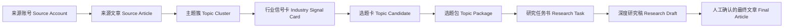
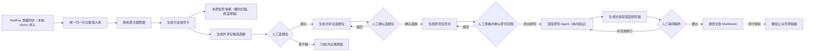
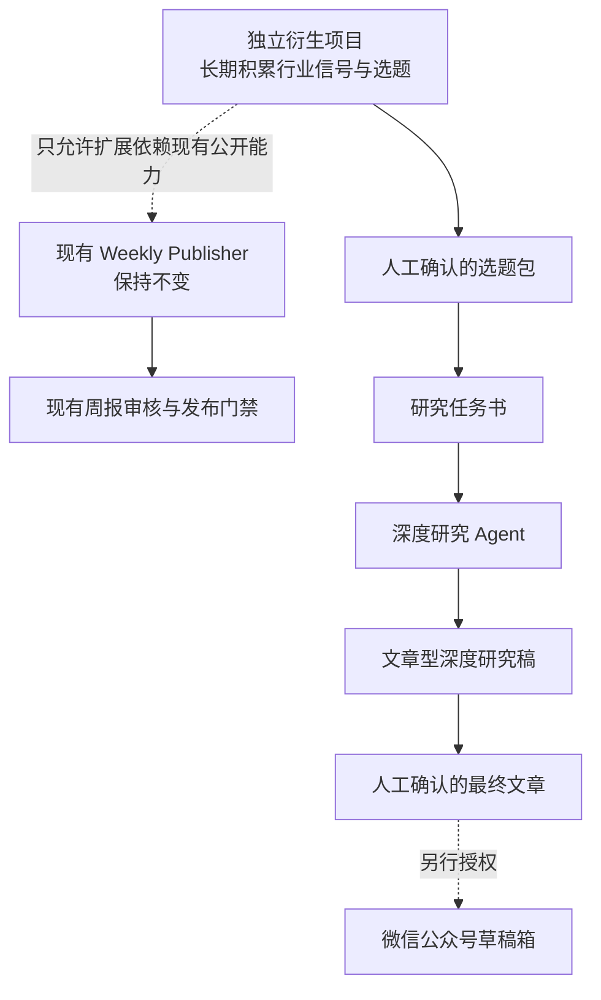

# 营养健康行业信号雷达（需求基线）

状态：`Requirements Confirmed — Independent Repository Migrated — Weekly Horizontal Brief + Vertical Deep-Research Branches Confirmed`
更新时间：2026-08-15

本文件保存 grilling 中形成并经用户确认的需求基线。用户已于 2026-08-06 确认共同理解达成，可以进入实施规划与任务拆分；具体执行顺序见 [实施计划](IMPLEMENTATION_PLAN.md)。

## 1. 需求与已知事实

本提案解决的不是“抓到公众号文章”，而是把一批公众号文章转化为可决策、可追溯的行业信号，再从中形成可推进的原创内容选题。

当前已明确：

- 正式来源后续使用 RedFox 获取公众号文章列表、正文和可用互动指标。
- 第一版 Demo 先只读导入 `D:/Earlydata/SentimentTracker/data/input/P&B微信公众号3月数据.xlsx`；任何数据库和派生产物仍只写入扩展自己的 `var/`，不得修改或搬动输入工作簿。
- Excel 与未来 RedFox 必须先转换成同一个来源中立的文章契约，主题聚类、行业信号和选题流程不根据来源类型分叉。
- 首批监测名单包括“庶正康讯”“营养健康评论”“Bonny营养领航”“健康产业观察”“营养品观察”和此前已在名单中的“功能食品圈”。
- 需要支持从素材发现、选题判断到文章型深度研究稿审阅和最终文章确认的流程。
- 希望通过相互关联但彼此独立的选题看板和研究看板管理工作。
- 服务对象是营养健康、营养品和功能食品行业中的品牌方、原料商及企业决策者。
- 内容定位是服务咨询的“行业判断型内容”，不是消费者健康科普或资讯搬运。
- 当前监测的主要是行业媒体公众号，不足以代表消费者情绪、传播网络或完整社会舆情，因此不把该阶段命名为“舆情分析”。
- 公众号分析阶段的直接产物是“行业信号卡”，用于展示议题热度、共识与分歧、证据状态、业务影响和数据缺口；它不是文章。
- 本方案是从现有周报实践派生的独立项目，不是 `earlydata-weekly` 的新增功能模块；现有项目的代码、命令、状态机、配置、文档和行为全部保持不变。
- 本项目已于 2026-08-14 迁至独立 Git 仓库；历史 `SentimentTracker` / Weekly Publisher 保持不变，不共享代码、运行库或状态。
- 独立衍生项目正式命名为“营养健康行业信号雷达”；当前版本除“本期选题归档”外，还提供横向“本周信号快报”与 pi 生成、人工确认后可发布的“可发布周报文章”；纵向深度研究经人工选题确认后形成高价值文章。
- 选题包、研究任务书和深度研究稿是不同产物；深度研究稿兼具证据完整性和微信公众号文章结构，人工审阅后直接成为最终文章，不再额外生成独立研究报告。
- 选题包是可审阅的中间产物；人工确认后转化为独立研究任务书，再交给深度研究 Agent 形成文章型深度研究稿。
- 选题进入研究前、深度研究稿成为最终文章前都设置人工门禁；选题包、研究任务书和深度研究稿均可直接打开查看。
- 当前扩展不自动发布文章，也不触发微信公众号写接口；最终文章确认与发布授权始终分开。
- `D:/Earlydata/2026-Q2.html` 中的竞争动作、趋势、人群、产品、科研叙事、市场活动、竞品、舆情合规、管理层观察及业务含义等维度用于选题判断和研究范围设计，不直接作为文章章节模板。
- 来源文章必须先聚合成主题簇，再形成行业信号卡，最后从行业信号生成选题；不为每篇文章直接创建选题。
- 每个行业信号按证据情况生成 1—3 个差异化候选选题，不强行凑满数量。
- 采用双节奏运营：每日自动增量抓取、聚类并更新行业信号和候选选题，每周进行一次人工信号与选题审阅。
- 强时效主题可直接进入“待决策”，不等待每周选题会。
- 首版是本地单人工作台，不包含登录、权限、任务分配或多人实时同步。
- 公众号来源使用可编辑监测名单，可新增、停用和调整优先级；系统不自动发现账号。
- 监测公众号是发现源；监管、功效、科研和市场数据等事实性主张应补充一手来源。
- 暂无一手来源时保留选题并标记“待补证”，不得将相关主张表述为已确认事实。
- 选题阶段采用人工补证：系统列出待核实主张，操作者补充公开网页、监管文件、开放论文或互联网公开附件并人工确认；不做自动联网查证。
- 研究启动支持手动与自动两种可配置策略，默认关闭自动启动；无论采用哪种策略，都必须先由人工查看并确认研究任务书。
- 研究启动策略切换不追溯已有任务：开启自动启动后，只对之后新确认的任务生效，原有“待启动”任务保持不动。
- AI 评分只用于排序、标记和解释，不得自动淘汰、归档或立项；所有候选选题的最终处置由人工决定。
- 首版深度研究只检索互联网公开资料，不接入付费数据库或内部数据库，也不保存或代用任何第三方账号凭据；重点网站配置可作为后续增强。
- 重点网站采用可编辑的“优先来源清单”，不是严格白名单；第一批候选从 `D:/Earlydata/2026-Q2.html` 提取，官网首页只能用于发现内容，具体事实必须关联到具体证据页面。
- 深度研究稿退回后在同一个研究任务下生成递增版本，保留旧版本、退回原因和变更说明；核心研究问题、目标读者、决策用途、研究对象、地域、主要时间范围发生变化，或已完成后发起新一轮跟踪时，创建与原任务关联的新研究任务。
- 第一版不支持研究任务合并、稿件改挂或物理删除；误建任务标记为“已取消—误建”并保留原因，以简单、可追溯的异常处理代替复杂迁移工具。

产品边界与首版范围已经确认。评分权重、提示词和页面细节可以在不改变人工门禁及产物边界的前提下，通过实现验证和人工反馈继续校准。

## 2. 产品判断

可以设计看板，而且应采用两张关联看板：选题看板管理“是否值得研究”，研究看板管理“研究任务和深度研究稿是否完成”。来源文章不是看板主对象，最终文章是研究稿通过人工审阅后的终态。

原因：

1. 多个公众号可能在同一时间讨论同一政策、原料、产品或消费趋势。
2. 一篇文章可能只能提供一个线索，多篇文章去重聚合后才足以判断是否形成值得关注的行业信号。
3. 编辑真正要决定的是“写什么、为什么现在写、以什么差异化角度写”，而不是“哪篇文章被抓到了”。

因此系统应区分以下核心对象：



- 来源账号：被持续监测的公众号。
- 来源文章：本地 Excel 或未来 RedFox 经统一契约归一化后保存的原始证据；来源类型和原始定位信息必须可追溯。
- 主题簇：一组在讨论同一事件或趋势的文章。
- 行业信号卡：对一个主题簇的可审阅研判，展示议题热度、独立来源、共识与分歧、证据状态、受影响角色、业务含义和数据缺口。
- 选题卡：编辑部可以立项的内容命题，必须包含目标读者、核心问题、时效理由和差异化角度。
- 选题包：经人工确认的选题中间产物，包含题目、时效理由、行业判断角度、适用维度、已有证据、证据缺口和风险提示。
- 研究任务书：从一个已确认选题包生成的独立研究指令，明确研究问题、范围、证据缺口和稿件要求，启动前可由人工查看和修改。
- 深度研究稿：Agent 针对研究任务书形成的文章型研究产物，正文适合微信公众号阅读，并保留可追溯来源、结论、不确定性、行业影响和行动启示，产出后必须经过人工审阅。
- 最终文章：深度研究稿经过人工事实审阅和编辑确认后的版本；确认文章不等于授权发布。

## 3. 推荐工作流



### 3.1 运营节奏

- 每日自动执行增量抓取、主题聚类、行业信号卡和候选选题更新。
- 每周可生成“本周信号快报”横向扫描草稿和“可发布周报文章”成品，再集中审阅行业信号和候选选题、确认选题包；快报与“本期选题归档”都是内部工作稿，文章成品由 pi 按参考文体生成、人工确认后发布。
- 重大监管、原料获批、安全风险等强时效主题直接进入“待决策”，不等待周会。

### 3.2 抓取

建议以增量抓取为主：

当前首批监测名单如下；这是可编辑名单，不应写死在抓取代码中：

| 公众号名称 | 初始状态 | 备注 |
| --- | --- | --- |
| 庶正康讯 | 已启用（广域库） | 优质库未收录；广域库精确作者命中 38/40，2026-08-15 起按广域库同步 |
| 营养健康评论 | 已启用（优质库） | account `ztyyjkpl`，名称精确匹配 |
| Bonny营养领航 | 已启用（广域库，人工链接补录） | 广域库作者名精确为“Bonny营养领航”，但关键词搜索无法按账号名枚举其文章；由操作者确认后通过 `sources import-article` 补录单篇链接 |
| 健康产业观察 | 已启用（优质库） | account `jianguancn`，名称精确匹配 |
| 营养品观察 | 已启用（优质库） | account `yingyangpinguancha`，名称精确匹配 |
| 功能食品圈 | 已启用（优质库） | account `foodmate-gnspq`，名称精确匹配 |

- 操作者可以编辑监测名单；只有已启用的账号参与抓取。
- 新增账号必须先通过 RedFox 精确名称校验，并显示命中状态。
- 默认每天抓取一次，使用 3 天回看窗口，按 RedFox `workUuid`、原文 URL 或内容指纹幂等更新。
- 首次上线先回溯 30 天，用于检验账号名称、文章覆盖率、主题分类和重复率。
- 账号名称必须以 RedFox 可识别的精确名称为准；首轮试抓应输出“命中 / 未命中 / 最近文章时间”清单。
- 原始响应和标准化文章分开保存，避免 RedFox 字段变化后无法追溯。
- 正文仅作为内部研究和证据，不直接改写后公开发布。

当前扩展已经实现来源中立的文章契约和本地 Excel 适配器。后续 RedFox 网关独立输出同一契约，并补充长期增量同步、原始响应快照、跨窗口去重和抓取健康度；不得通过修改现有 Weekly Publisher 来实现。

#### 重点网站候选清单

深度研究阶段可以使用一份独立、可编辑的重点网站清单来提高公开检索的稳定性。该清单只影响检索优先级，不限制 Agent 检索清单以外的互联网公开资料；停用网站也只取消优先检索，不构成系统级屏蔽。

从 `D:/Earlydata/2026-Q2.html` 的 84 条参考记录中提取到 31 个内容域名，可作为第一批种子。由于其中 67 条指向企业、品牌或原料商域名，且 71 条只指向首页或语言入口，这批网站主要适合建立企业与竞品观察范围，不能替代监管与学术来源。完整分组和证据规则见 [重点网站清单草案](SOURCE_REGISTRY_DRAFT.md)。

每个网站至少记录名称、域名、来源类别、来源角色、优先级、启用状态、适用主题、证据规则、来源出处和最后校验时间。企业官网可以证明该企业自己的公开动作或主张，但不能单独确认功效、科研或监管结论；媒体和用户内容平台默认只作线索。首页链接不能满足事实证据要求，选题包和深度研究稿必须保存具体文章、公告、论文、活动页或文件 URL。

### 3.3 归一化与主题聚类

每篇文章至少保留：

- `external_id`、账号、标题、发布时间、原文链接、正文快照、互动指标、抓取时间。
- 内容分类：政策监管、原料/成分、科研证据、产品创新、品牌案例、渠道市场、消费趋势、争议辟谣等。
- 实体：成分、功效、品牌、企业、机构、法规、疾病/健康场景、人群。
- 来源属性：原创/转载判断、商业软文风险、证据类型、是否属于一手来源。

聚类不能只做标题完全去重。建议同时使用规范化标题、关键词/实体重合和语义相似度，在滚动 30 天窗口内形成主题簇。编辑可以手工拆分或合并错误聚类。

首批监测公众号定位为“发现源”，不能把多个账号转载同一新闻稿误算为多份独立证据。主题簇需要标记共同稿源和文本高度重合；监管、功效、科研和市场数据等事实性主张应补充监管文件、原始论文、企业原始公告或数据报告原文等一手来源。暂时找不到时保留行业信号和选题并标记“待补证”，不得将相关主张表述为已确认事实。

### 3.4 行业信号卡

每个主题簇先生成一张可直接查看的行业信号卡，至少回答：

1. 底层发生了什么，首次和最近出现在什么时间？
2. 有多少篇文章、多少个去重后的独立来源？
3. 议题在升温、持续还是回落？
4. 各来源的共识、分歧和明显商业立场是什么？
5. 哪些是已核实事实，哪些仅是观点或待补证主张？
6. 可能影响哪些品牌方、原料商或企业决策者？
7. 要形成更强判断，还需要什么市场数据、监管文件、论文或企业原始材料？

行业信号卡可以计算“行业媒体议题热度”和来源分歧，但不得把当前有限的行业公众号样本推断为消费者情绪或社会舆情。

### 3.5 选题生成

模型应针对“行业信号卡及其主题簇”生成选题，而不是为每篇文章都生成一个标题。每张选题卡至少回答：

1. 目标读者是谁？
2. 读者当前最关心的核心问题是什么？
3. 为什么现在值得写？
4. EarlyData 能提供什么不同于来源文章的角度？
5. 已有哪些证据，仍缺什么证据？
6. 有哪些医疗宣称、版权、事实或品牌偏向风险？

每个行业信号按证据情况生成 1—3 个候选选题，可以分别面向品牌方、原料商或企业战略视角；不要求每个主题都覆盖全部视角。

所有候选选题都保留可检索。评分和硬性风险只影响排序、提示标签及默认筛选，不自动改变状态；低分选题可以默认折叠，但必须由操作者决定是否进入“待决策”或归档。

参考 `D:/Earlydata/2026-Q2.html`，选题卡和选题包可以按需调用以下判断维度：

- 竞争动作：人群、新兴领域、新兴品牌和服务差异化。
- 核心趋势与市场信号。
- 人群细分。
- 产品端：品类、功效、新品趋势和剂型。
- 科研证据、科学叙事与对外宣发。
- 展会、活动、渠道与社交媒体动作。
- 本土龙头与跨国竞品。
- 舆情、监管与合规。
- 管理层观察清单及下一阶段动作。
- 对目标品牌、原料商或企业决策者的业务含义。

系统只选择与当前主题真正相关的维度，不要求全部填满。这些维度用于判断“值不值得研究、应研究什么”，不直接生成固定文章目录。

### 3.6 研究交接与深度研究稿

人工确认选题包后，系统生成独立研究任务书。任务书至少包含：

- 核心研究问题和目标决策者。
- 研究范围、时间范围和明确排除项。
- 本选题采用的判断维度及选择理由。
- 已知证据、待补证主张和相互冲突的信息。
- 需要覆盖的公开网站、官方文件、开放论文或公开论文摘要。
- 稿件必须回答的问题、来源要求、微信公众号正文长度和期望交付形式。

研究任务书必须可直接查看和编辑。通过人工门禁后，系统按研究启动策略执行：默认进入“待启动”，由操作者逐个点击启动；显式开启自动启动后，任务书一经人工确认即可进入“研究中”。自动启动不得绕过任务书确认。启动策略只在任务确认时读取一次；切换为自动模式不会追溯启动此前已经处于“待启动”的任务。

深度研究稿正文应采用简洁的微信公众号文章结构，聚焦一个核心判断、必要的分析段落和可执行建议；文末保留来源链、冲突证据、不确定性和待补证说明。每个重要事实必须能够回到来源，不能因进入研究阶段而自动变成已确认事实。

深度研究稿必须可直接查看、退回补充或确认成最终文章。退回后在同一研究任务下生成下一版本，旧版本不可覆盖，并记录退回原因和变更说明。确认最终文章不自动触发微信公众号发布。

补充来源、纠正事实、强化论证、调整结构或增删次要问题属于普通修订。核心研究问题、目标读者、决策用途、研究对象、地域或主要时间范围变化，以及最终文章完成后的新一轮跟踪，必须创建新研究任务；新任务保留与原任务的派生关系。系统可以提示范围变化，但最终由操作者确认是否新建任务。

## 4. 看板设计

### 4.1 选题看板

选题看板只回答“这个主题是否值得进入深度研究”。为避免单人工作台把操作细节误当作决策阶段，默认只展示三段：

在选题生命周期之外，候选先按审阅目的暂分为“值得研究”和“传播观察”。前者优先承载监管、市场、科研、原料、产品和企业动作等决策线索；后者保留会议活动、资讯汇总、多号同稿传播及暂未识别明确决策价值的线索。审阅队列不是新的生命周期状态，也不自动立项或归档。规则只给出初始建议，操作者可人工改类并留痕；人工改类不因之后重跑规则而被覆盖。

| 展示阶段 | 操作者关注点 | 包含的细分操作 |
| --- | --- | --- |
| 待判断 | 是否值得投入时间完善为选题包 | 候选池、人工判断、选题包完善；卡片显示下一步而非要求理解这些细分名称 |
| 待确认 | 选题包是否可以由人工确认 | 已提交且字段锁定的完整选题包 |
| 已选题 | 是否进入独立研究任务书 | 人工已确认的选题；可直接打开结构 Demo 或创建研究任务书 |

候选池、人工判断和选题包完善仍是必须留痕的细分操作，不能跳过完整性检查或人工确认；它们只在详情页、下一步提示和事件记录中可见，不再各占一个主看板列。详情默认只展示一项前进操作，退回、改队列和归档收纳为“更多操作”。

“归档 / 不做”是终止动作，不占用主看板列。归档时必须选择原因，例如：重复、过时、证据弱、偏离受众、商业软文、已有同类内容、资源不足。

### 4.2 研究看板

研究看板只回答“这个研究任务和深度研究稿推进到哪里”，不重复维护选题状态。默认同样只展示三段：

| 展示阶段 | 操作者关注点 | 包含的细分操作 |
| --- | --- | --- |
| 任务书 | 研究范围是否完整、是否人工确认、是否该启动 | 任务书草稿与已确认但待启动的任务；界面用“补全并确认”或“等待人工启动”提示下一步 |
| 稿件 | 稿件是否已生成、是否需要人工审阅 | 研究执行与稿件待审；退回后仍在同一研究任务生成下一版本 |
| 已定稿 | 是否已保存可存档的最终文章 | 人工已审阅并确认的最终文章；发布仍需独立授权 |

“取消 / 误建”继续作为研究任务的终止动作，不占用主展示阶段。细分操作仍用于人工门禁和审计，但不要求操作者在看板首页理解完整状态机。

默认关闭自动启动。自动模式只能在人工确认任务书后跳过“待启动”进入“研究中”；开启自动模式只影响此后新确认的任务，已有“待启动”任务保持不动。策略变更、人工确认和实际启动均必须留下记录。

第一版不提供任务合并、稿件改挂或物理删除：误建任务标记为“已取消—误建”并记录原因，操作者随后回到原任务或创建正确的新任务。

### 4.3 页面布局

```text
┌──────────────────────────────────────────────────────────┐
│ [行业信号] [选题看板] [研究与成稿] [来源流]                     │
├──────────────────────────────────────────────────────────┤
│ 审阅队列 | 来源账号 | 风险 | 分数 | 搜索                         │
├──────────────────┬──────────────────┬─────────────────────┤
│ 待判断            │ 待确认            │ 已选题              │
│ 新候选默认前 10   │ 完整选题包         │ 可创建研究任务书     │
│ 处理中卡片完整显示│ 人工确认门禁       │ ...                 │
└──────────────────┴──────────────────┴─────────────────────┘
```

完整扩展至少提供五个视图：

- 行业信号流：按热度、时效、证据状态和受影响角色查看可审阅信号卡。
- 选题看板：推进主题从候选到人工确认选题的生命周期。
- 研究看板：查看研究任务书、研究进度和待审深度研究稿。
- 来源流：按账号和时间查看抓取文章，用于漏抓排查和人工发现。
- 主题详情：查看主题趋势、相关文章、相同/不同观点和证据缺口。

行业信号卡、选题包、研究任务书和深度研究稿详情页都应有稳定链接，可以跨视图直接查看上下游产物。“发布效果复盘”可以后置，避免首版变成泛舆情平台。

### 4.4 行业信号卡字段

信号卡正面显示：

- 信号标题和底层事件。
- 议题状态：升温、持续或回落。
- 文章数、去重后独立来源数、首次与最近出现时间。
- 证据状态、商业软文风险和待补证数量。
- 受影响角色和最核心的业务含义。

展开后显示：

- 主题簇和去重后来源文章。
- 不同来源的共识、分歧和明显立场。
- 事实、观点与待补证主张的分开展示。
- 对品牌方、原料商和企业决策者的分别影响。
- 需要进一步查询的监管网站、开放论文、企业官网或其他互联网公开材料。
- 关联候选选题及不生成选题的原因。

### 4.5 选题卡与选题包字段

卡片正面只显示决策所需信息：

- 建议题目。
- 内容支柱 / 目标读者。
- “为什么现在写”一句话。
- 综合分及最高、最低评分项。
- 来源数量、涉及账号、最近更新时间。
- 风险标记、优先级、期望完成时间。

展开后显示：

- 核心问题与推荐角度。
- 与已有内容相比的差异化说明。
- 3—5 个关键证据点及其原文链接。
- 每个事实性主张的证据状态：已核实或待补证。
- 人工补证入口，支持公开网址、来源名称、页面标题、发布日期、说明、截图或从公开来源下载的附件。
- 不同来源之间的一致观点和分歧。
- 缺失证据、待采访对象或待查的一手资料。
- 建议提纲、备选标题。
- 状态变更、人工修改和归档理由。

首版在“选题包完善”阶段直接编辑最终标题、目标读者、核心问题、时效理由、行业判断角度、判断维度、待补证事实、研究方向和风险提示。草稿可以分次保存；只有上述内容、至少一条公众号发现线索及其待补证状态完整时，后端才允许提交人工确认。进入“待确认”后字段锁定，如需修改必须退回“选题包完善”。人工确认选题仅结束 0.1 选题流程，不自动生成或启动研究任务；进入 0.2 后，由操作者在已选题详情中显式生成研究任务书。

### 4.6 研究任务书与报告字段

研究任务书正面显示：

- 关联选题、目标读者和核心研究问题。
- 研究范围、时间范围、所选判断维度。
- 已有证据数、待补证项数和风险标记。
- 当前状态、创建时间和最近更新时间。

展开后可查看和编辑：

- 完整研究任务书及明确排除项。
- 关联选题包、行业信号卡、主题簇和来源文章。
- 公开网站、官方文件、开放论文和公开论文摘要的检索要求。
- 深度研究稿的必答问题、正文长度和交付要求。
- 人工确认、退回、停止和启动记录。

深度研究稿正面显示标题、版本、状态、生成时间、来源数量、待补证数量和审阅结果；展开后显示文章正文、逐项来源、冲突证据、不确定性以及人工审阅记录。版本历史应允许查看任一旧版本，并展示触发本次修订的退回原因、相对上一版本的变更说明和版本生成时间。

## 5. 评分与门禁

针对已确认的行业决策者，可使用以下 100 分默认模型：

| 维度 | 权重 | 判断问题 |
| --- | ---: | --- |
| 目标读者适配 | 25 | 是否直接回答核心读者的业务或认知问题？ |
| 时效与趋势势能 | 20 | 是正在形成的趋势，还是已经过时的单点新闻？ |
| 差异化空间 | 20 | 能否形成自己的判断，而不是改写来源文章？ |
| 证据强度 | 15 | 是否有多来源或一手证据，事实是否可核查？ |
| 业务价值 | 10 | 是否支持品牌定位、客户教育或行业影响力？ |
| 生产可行性 | 10 | 在时间、采访和数据条件内能否高质量完成？ |

建议门禁：

- `≥ 75`：在候选池标记“优先”。
- `60—74`：在候选池标记“需补充角度或证据”。
- `< 60`：在候选池标记“低优先”，默认可折叠或筛选，但不得自动归档或删除。

评分只改变排序和提示标签，不自动改变选题状态。进入“待决策”、立项或归档都必须由操作者执行；归档时仍需记录原因。

以下情况不论分数多高都必须人工复核：

- 医疗、营养功效或安全性结论缺少一手证据。
- 主要证据来自单一品牌软文。
- 多篇文章来源于同一新闻稿，却被当成独立证据重复计分。
- 拟定角度与来源文章过于接近，存在改写或版权风险。
- 事实之间存在冲突，或文章发布时间和事件发生时间不一致。
- 以阅读、点赞等互动指标替代内容价值判断。

互动数据只作为“公众号内容注意力”的弱信号，不代表市场需求或消费者情绪，也不直接决定选题排序。

## 6. 建议数据模型

| 实体 | 关键字段 |
| --- | --- |
| `source_accounts` | `id`、`name`、`segment`、`priority`、`enabled`、`last_synced_at`、`sync_health` |
| `priority_sites` | `id`、`name`、`domain`、`category`、`source_role`、`priority`、`enabled`、`applicable_topics`、`evidence_policy`、`derived_from`、`last_validated_at` |
| `source_articles` | `id`、`external_id`、`account_id`、`title`、`published_at`、`url`、`content_snapshot`、`metrics`、`content_hash` |
| `monitoring_cycles` | `id`、`slug`、`label`、`start_date`、`end_date`、`data_cutoff`、`status`、`closed_at` |
| `monitoring_cycle_articles` | `cycle_id`、`article_id`、`role`（`in_period` / `context`）、`added_at` |
| `monitoring_cycle_events` | `cycle_id`、`event_type`、`actor`、`reason`、`payload`、`created_at` |
| `cycle_exports` | `cycle_id`、`export_kind`、`version`、`status_snapshot`、`relative_path`、`manifest_sha256`、`file_count` |
| `topic_clusters` | `id`、`cycle_id`、`canonical_name`、`first_seen_at`、`last_seen_at`、`article_count`、`source_count`、`trend_state` |
| `cluster_articles` | `cluster_id`、`article_id`、`similarity`、`is_primary_evidence` |
| `industry_signals` | `id`、`cluster_id`、`signal_title`、`underlying_event`、`first_seen_at`、`last_seen_at`、`trend_state`、`article_count`、`independent_source_count`、`consensus`、`disagreements`、`evidence_status`、`affected_actors`、`business_implications`、`data_gaps`、`status` |
| `topic_candidates` | `id`、`signal_id`、`proposed_title`、`audience`、`core_question`、`why_now`、`angle`、`score`、`risk_flags`、`status` |
| `topic_packages` | `id`、`candidate_id`、`title`、`audience`、`core_question`、`why_now`、`industry_angle`、`selection_dimensions`、`evidence`、`evidence_status`、`evidence_gaps`、`research_directions`、`risk_notes`、`status`、`editor_modified`、`submitted_at`、`confirmed_at` |
| `evidence_records` | `id`、`candidate_id`、`claim`、`status`、`source_type`、`source_name`、`title`、`url`、`published_at`、`attachment_path`、`note`、`verified_at` |
| `topic_events` | `candidate_id`、`event_type`、`actor`、`from_status`、`to_status`、`reason`、`created_at` |
| `research_tasks` | `id`、`topic_package_id`、`parent_task_id`、`new_task_reason`、`research_question`、`audience`、`decision_use`、`scope`、`geography`、`time_range`、`exclusions`、`selection_dimensions`、`known_evidence`、`evidence_gaps`、`output_requirements`、`status`、`start_mode`、`confirmed_at`、`start_requested_at`、`started_at`、`cancelled_at`、`cancellation_reason` |
| `research_drafts` | `id`、`research_task_id`、`supersedes_draft_id`、`title`、`article_body`、`key_judgment`、`action_implications`、`uncertainty_notes`、`version`、`revision_reason`、`change_summary`、`status`、`generated_at`、`reviewed_at` |
| `research_sources` | `id`、`draft_id`、`claim`、`source_type`、`title`、`url_or_reference`、`evidence_status`、`accessed_at` |
| `research_events` | `research_task_id`、`draft_id`、`event_type`、`actor`、`from_status`、`to_status`、`reason`、`created_at` |

本地单人工作台推荐 SQLite，因为行业信号、两张看板的状态、选题与研究之间的关联、稿件版本和事件历史不适合继续堆在按周生成的 JSON 文件里。来源文章在同一个数据库中全局去重；监测期次通过关联表复用来源文章，并隔离主题簇、行业信号和选题状态。关闭期次后这些上游编辑状态只读，新一期在同库中创建空白工作区；关联研究任务属于独立下游生命周期，仍可从已确认的历史选题创建和推进，但不得改写历史选题包。JSON 保留为导入、导出和 Agent 调用的稳定交换格式；Markdown 用作人工触发、不可覆盖的本地阅读归档。需要多人实时协作时再迁移到 Postgres，不在首版提前引入。

## 7. 与现有周报系统的关系

营养健康行业信号雷达是与现有 Weekly Publisher 并列的独立衍生项目，不是其内部功能模块，也不改写现有周报状态机：



项目最初在 `extensions/content-topic-radar/` 内建立了独立边界；2026-08-14 已迁至本独立 Git 仓库。它保留自己的包、命令入口、配置和数据空间，不给 `earlydata-weekly` 增加状态，也不依赖历史仓库的运行目录。

如果衍生项目需要使用现有项目已经公开且稳定的只读能力，依赖方向只能是“衍生项目 → 现有系统”；现有系统不得反向依赖衍生项目。任何会要求修改现有接口的复用都暂停，改由衍生项目拥有自己的适配层。

独立仓库迁移已确认并记录在 [ADR-0010](docs/adr/0010-independent-repository-migration.md)。后续抽取共享模块或接入现有发布流程仍属于新的独立决策，不能作为当前项目的默认实施步骤。

两者不共享状态和产物；新增的选题、研究任务和深度研究稿也全部留在扩展自己的数据空间：

- 生命周期状态。
- 持久化目录 / 数据库。
- 配置、评分提示词和命令入口。
- “周报已批准”与“选题已立项”等业务含义。

现有周报规则会主动降低泛健康、饮食、睡眠等内容的优先级，与营养健康选题的目标并不兼容，因此不能直接复用周报排名结果或提示词。

已确认的隔离边界见 [ADR-0001](docs/adr/0001-isolated-extension.md)。
独立仓库迁移的当前决定见 [ADR-0010](docs/adr/0010-independent-repository-migration.md)。
旧的“研究报告再转文章”方案见已被取代的 [ADR-0004](docs/adr/0004-separate-topic-research-writing.md)；首版合并深度研究与文章初稿的决定见 [ADR-0008](docs/adr/0008-article-shaped-deep-research-draft.md)；离线文章 Demo 与真实深度研究严格区分的决定见 [ADR-0009](docs/adr/0009-offline-article-demo-is-not-deep-research.md)。
将公众号分析定义为行业信号而非舆情的决定见 [ADR-0005](docs/adr/0005-industry-signals-not-sentiment.md)。
先用只读本地 Excel 构建 Demo、后接 RedFox 的决定见 [ADR-0006](docs/adr/0006-local-xlsx-demo-before-redfox.md)。
单库逻辑期次隔离和版本化 Markdown 归档的决定见 [ADR-0007](docs/adr/0007-logical-monitoring-cycles.md)。

## 8. 分阶段落地

### Phase 0A：本地数据 Demo 验证（选题闭环已完成）

- 以只读方式检查并导入现有 P&B 工作簿。
- 将 1,731 行归一化为 1,677 篇文章，合并 54 行微信 URL 跟踪参数造成的重复快照，0 行跳过。
- Demo 数据库存放在扩展的 `var/demo/radar.sqlite3`，不污染未来正式库。
- 该数据集用于验证机制，不据此验收营养健康正式来源的覆盖质量。
- 已基于 1,677 篇文章形成 1,358 个主题簇；196 个多文章主题生成行业信号卡和候选选题卡，并进入可操作的本地看板。
- 未配置 DeepSeek 时使用明确标注的确定性规则；账号覆盖结合正文近似去重形成“独立来源估算”，不得称为独立证据验证。
- 规则 v3 将 196 个候选暂分为 77 个“值得研究”和 119 个“传播观察”；会议活动、培训推广、资讯汇总及同稿传播优先进入观察队列，互动量只作弱信号并按独立来源估算折算。
- 支持人工改类和编辑选题核心字段；人工操作留痕并在规则重跑后保留，审阅队列不替代任何人工门禁。
- 看板默认显示“待判断、待确认、已选题”三段；候选池、人工判断和选题包完善作为细分操作仍由人工逐级推进，归档必须填写原因。
- 选题包支持分次保存、完整性检查、提交锁定和退回编辑；公众号材料只作为发现线索并标记“待补证”，确认选题不自动启动研究。
- schema v5 增加监测期次：来源文章继续全局去重，主题簇、行业信号和选题按期隔离；关闭期次后只读，下一期创建空白工作区。
- 看板支持切换、新建和关闭期次，并可人工导出版本化“本期选题归档”；每次导出生成独立 `vNNN` 目录，只包含选题快照、已有选题包和清单，不覆盖旧档，也不生成行业周报、深度研究稿或最终文章。
- 已选题卡片和详情可打开与该题匹配的静态微信公众号文章结构 Demo；它不代表已经执行深度研究。
- schema v6 增加研究任务书与事件表；操作者可从已确认选题显式生成、编辑并人工确认任务书，确认后停在“待启动”，不调用研究 Agent。
- schema v7 增加版本化稿件、稿件来源与稿件事件关联；在真实公开互联网研究 Agent 接入前，操作者可手动启动明确标记为“未联网”的离线文章 Demo，以验证稿件审阅、退回、版本和最终 Markdown 存档，但不把它称为深度研究。

退出标准：本地真实数据可重复、幂等地进入统一文章模型，且源工作簿保持不变。当前已满足。

### Phase 0B：RedFox 数据可用性验证（后续）

- 用首批监测名单中的全部已启用账号回溯 30 天。
- 验证 RedFox 精确账号名、文章量、正文成功率、互动字段和重复率。
- 人工抽检 30 篇，确认来源内容是否足以支持选题。
- 产出账号健康表，不生成正式内容。

退出标准：首批账号的命中情况明确，正文获取成功率和漏抓风险可量化。

### Phase 1：本地选题 MVP（先基于 Excel Demo）

- 先基于统一文章契约完成简单的主题聚合、行业信号和选题看板；RedFox 后续作为可替换来源网关接入，不编辑现有实现。
- 建立 SQLite 文章、主题、行业信号、选题和事件表。
- 实现增量同步、去重、基础分类、主题聚类、行业信号卡和选题评分。
- 提供本地网页：行业信号流、选题看板、来源流、主题详情。
- 支持人工修改选题卡、拖动状态、归档并记录原因。
- 每周可由操作者导出“本周信号快报”横向扫描草稿，或运行 `weekly article generate --live` 生成《营养保健行业周报》成品；快报是等待人工审阅的只读工作稿，文章成品正文禁止“待补证”等内部标记且须人工确认后才能发布。

退出标准：一次每周信号与选题审阅可以完全在工作台中完成，每张行业信号卡和立项卡都能回到去重后来源与原文。

### Phase 2：文章型深度研究稿

- 将人工确认的选题包转换为独立研究任务书。
- 提供研究任务书详情页，支持人工查看、修改、确认和停止。
- 支持手动与自动两种研究启动策略，默认关闭自动启动；自动模式仍受研究任务书人工确认门禁约束。
- 仅检索无需付费账号或内部权限的互联网公开资料；不建设付费数据库、内部数据库或账号凭据接入。
- 支持可编辑重点网站清单并优先检索，但不把它作为互联网严格白名单。
- 接入深度研究 Agent，保存任务输入、执行状态、来源和稿件版本。
- 提供深度研究稿详情页，正文采用简洁的微信公众号结构，支持直接查看、退回补充和人工确认最终文章。
- 稿件退回后在同一任务生成新版本，保留旧版本、退回原因和变更说明，不覆盖历史稿件。
- 首版不实现任务合并和稿件改挂；误建任务通过“已取消—误建”状态留痕处理。
- 延续“待补证”规则，不把 Agent 生成的结论自动视为已核实事实。

退出标准：从选题包到研究任务书再到已审阅最终文章的决策链和来源链完整，每一次跨阶段推进都有人工记录。

### Phase 3：未来发布与运营闭环（独立决策）

- 只有在另行确认和授权后，才把最终文章转换为公众号兼容 HTML 并写入草稿箱。
- 记录发布链接和表现数据。
- 分析“来源类型 / 选题类型 / 原创角度”与发布表现的关系。
- 用复盘结果调整评分权重，而不是让单篇爆款直接控制模型。

## 9. 分阶段验收标准

- 重复同步不会重复创建文章。
- 同一事件的多来源文章能够聚为一个主题，且可以人工纠正。
- 每个活跃主题簇都有一张可直接查看的当前行业信号卡，能分开文章数与去重后独立来源数。
- 行业信号卡可展示行业媒体议题热度和来源分歧，但不将其标注为消费者情绪或社会舆情。
- 每张候选选题都能回到关联行业信号卡和主题簇。
- 每张选题卡至少关联一个可打开的原文链接；高优先级卡建议有两个独立来源或一个一手来源。
- 事实性主张缺少一手来源时必须标记“待补证”，不得显示为已核实。
- 编辑能在选题看板上完成筛选、选题包完善、人工确认和归档。
- AI 评分只能影响排序和提示，任何分数都不会自动淘汰、归档或立项。
- 一个已确认选题只创建一个可追溯的研究任务书，选题包与任务书均可直接查看。
- 研究任务通过人工门禁后才能进入深度研究；任务状态、输入和执行记录可追溯。
- 新环境默认关闭自动启动；研究任务书确认后先进入“待启动”，直至操作者点击启动。
- 开启自动启动后，未经人工确认的研究任务仍不得执行；启动策略和实际触发方式均可追溯。
- 启动策略切换只影响此后新确认的任务，不批量启动已有“待启动”任务。
- 深度研究稿可直接查看、退回补充或人工确认成最终文章，重要事实能够回到具体来源。
- 同一研究任务的稿件修订按版本递增；任一旧版本、退回原因和变更说明均可查看。
- 研究问题、受众、决策用途、对象、地域或主要时间范围改变时可以创建关联的新研究任务，原任务和派生原因保持可追溯。
- 误建研究任务可以取消并记录原因，但首版不存在任务合并、稿件改挂或物理删除入口。
- 首版研究来源全部来自互联网公开资料；系统不存在付费数据库、内部数据库或第三方账号登录入口。
- 重点网站可以新增、停用和调整优先级；事实证据必须保存具体页面 URL，官网首页不得直接满足证据门禁。
- 所有 AI 生成内容都明确标记，可人工修改并保留变更历史。
- 选题包、研究任务书和深度研究稿使用独立状态；深度研究稿通过人工审阅后直接成为最终文章。
- 系统不自动确认最终文章，也不触发任何发布动作。
- 现有 `earlydata-weekly` 状态机和发布门禁保持不变。

## 10. 基线状态

- 共同理解已经确认，本轮需求 grilling 结束。
- 行业信号向下游分叉为两条路径已确认：周度“本周信号快报”横向扫描（并升级出可发布周报文章成品），以及经人工确认选题后的纵向深度研究；边界见 [ADR-0011](docs/adr/0011-weekly-signal-brief-horizontal-scan.md) 与 [ADR-0013](docs/adr/0013-publishable-weekly-article.md)。
- 实施先用本地真实 Excel 完成简单选题 Demo，再通过相同文章契约接入 RedFox；文章型深度研究稿仍在选题 MVP 稳定后推进。
- 第一版不继续增加功能；新增想法进入后续清单，不改变当前退出标准。
- 现有 Weekly Publisher 继续保持完全不变。
- 具体任务、依赖、测试和止损条件见 [实施计划](IMPLEMENTATION_PLAN.md)。
