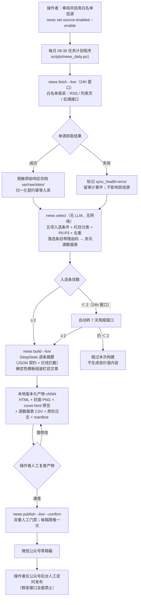

# 营养健康行业资讯：每日运营手册

本手册描述资讯自动线（Phase 4，[ADR-0014](adr/0014-news-line-and-wechat-draft-publishing.md)）的日常操作。自动化链路止于**本地产物**；向微信公众号草稿箱推送永远是人工显式动作。

## 0. 当前流程图



要点：实线自动化链路（fetch → select → build）每日无人值守，止步于本地产物；两个分支（周报回退、构建跳过）执行需求文档"不足不强更"；发布环节永远有人工门禁（`--live --confirm`），不在任何调度链内。二期候选：高优先级来源 2–4 小时加密抓取、Exa 兜底补捞（周一补抓）、`freepublish` 定时发布。

## 1. 一次性准备

| 事项 | 命令 / 位置 | 状态说明 |
| --- | --- | --- |
| 导入白名单提案 | `nutrition-radar news seed-sources` | 29 个建议信源，全部停用 |
| 审阅并确认名单 | `nutrition-radar news list-sources` | 人工确认是资讯线唯一固定的内容门禁 |
| 启用确认的信源 | `nutrition-radar news set-source-enabled --name "XX" --enable` | 只有启用的信源会被抓取 |
| 分析后端 | `.env` 的 `RADAR_LLM_*`（DeepSeek key） | `doctor` 报告 `llm_analysis_ready` |
| 封面 Logo（可选） | 放置 `var/assets/earlydata-logo.png` | 未放置时封面正常生成、仅无 Logo 并在 manifest 标注 |
| 微信凭据（发布前） | `.env` 的 `WECHAT_APP_ID` / `WECHAT_APP_SECRET` | 只在要推送草稿箱时需要 |

## 2. 每日自动链路（无发布）

`scripts/news_daily.ps1` 按 `fetch → select → build` 执行，建议用任务计划程序每日 08:30 调用：

```powershell
schtasks /Create /TN "EarlyDataNewsDaily" /SC DAILY /ST 08:30 `
  /TR "powershell -ExecutionPolicy Bypass -File D:\Earlydata\nutrition-signal-radar\scripts\news_daily.ps1"
```

三步也可手动执行：

```powershell
.\.venv\Scripts\nutrition-radar.exe news fetch --live --lookback-hours 24   # 抓取已启用信源
.\.venv\Scripts\nutrition-radar.exe news select                             # 规则筛选分级（无 LLM）
.\.venv\Scripts\nutrition-radar.exe news build --live                       # 摘要成文 + 本地产物
```

产物位于 `var/exports/news-articles/<slug>/vNNN/`：

- `news-article.html`：内联样式排版，可直接粘贴公众号编辑器；
- `news-article.md`：母稿；
- `cover.png`：1800×766 品牌封面（由入库模板 `templates/cover.html` 经本机 Edge/Chrome 无头截图生成，浏览器不可用时自动回退 PIL；`cover.html` 一并导出可直接在浏览器预览）；
- `source-table.csv`：资讯源数据表（含落选条目与理由）；
- `qc-log.json`：质检日志；`manifest.json`：构建元数据（含封面引擎与 Logo 状态）。

入选不足 2 条时自动转 7 天周报窗口；周报窗口仍不足则跳过本次构建，不生成低价值内容。

## 3. 发布（人工确认，手动触发）

检查 HTML 与封面后，人工确认推送草稿箱：

```powershell
.\.venv\Scripts\nutrition-radar.exe news publish --live --confirm --slug news-2026-09-01 --version 1
```

- `--live`：外呼确认；`--confirm`：人工决策确认——两者缺一即拒绝执行；
- 调度链永不包含 publish；每篇成稿只允许推送一次（重复执行会被拒绝并提示已有 media_id）；
- 推送后文章停在公众号草稿箱，**定时发布/群发由你在公众号后台人工操作**（群发接口在本项目中全面禁止）。

## 4. 健康检查与排障

- `news list-sources`：查看每个信源的 `sync_health`（healthy / error / paused）与最近抓取时间；
- 单个信源失败不影响其他信源；`error` 源的错误摘要可在事件表中追溯；
- 原始响应存档在 `var/raw/sites/YYYY-MM-DD/<域名>/`，用于核对解析问题；
- 政府站点改版常导致列表页解析失败：先看 `var/raw/sites/` 快照确认页面结构变化，再调整该源 `entry_url` 或解析配置（`news configure-source` 更新 `parser_version`）；
- 通用解析器约定：锚点 `title` 属性优先于截断的锚文本；支持"2026-09-01""2026年9月1日""09-01"（月-日自动补年份、纯日期按当天末尾计入窗口）等格式；列表页 JS 渲染抓不到内容时，优先换用站点自带的 RSS 或开放接口（如 WordPress 的 `/feed/`、`/wp-json/wp/v2/posts`）；
- 巨潮当前按 `parser_config` 的 `{"searchkey":"保健食品"}` 过滤标题；个股（stock 参数）过滤需先解析 orgId，留待专项调优。

## 5. 首轮实调记录（2026-09-01）

- 市场监管总局（列表页）：解析修复后正常（title 属性 + 月-日日期），当日 24h 窗口无新增；
- 巨潮资讯网（API）：未过滤查询返回 30 条并全部被规则正确判为"与产业无关"；改用 searchkey 过滤后噪声归零；
- HNC 健康营养展：首页为 JS 渲染、无静态新闻列表，已改用 WordPress RSS（10 条全部正确判为窗口外，该展 6 月闭展后暂未更新）；
- 当日入选 0 条 → build 诚实跳过：需求"资讯不足不强更"的真实演示。

### 5.1 全量活体校验（29 源，2026-09-01，脚本 `scripts/validate_news_sources.py`）

通用解析器增强后（锚点 title 属性、月-日短日期、GBK 编码回退、浏览器 UA），当前状态：

- **解析器可用（7）**：市场监管总局、巨潮资讯网、HNC（RSS）、北京市监局、商务部（编码修复后首页可解析）、中国食品科学技术学会、科拓生物/康恩贝（页面无标准列表，待换栏目页）；
- **页面通、需逐站调整入口或解析（15）**：上海/北京市局以外各品牌官网与展会站多为 JS 渲染新闻列表（ADM/Probi/Novonesis/SupplySide 等已探测无公开 RSS），需逐站把 `entry_url` 指向真实静态列表页或专用解析；
- **网络层失败（7）**：卫健委 412 反爬、WonderLab 403、海关总署/东阿阿胶/汤臣倍健/中国营养学会/CFSA 的 TLS 证书或握手问题（CFSA 解析器已人工验证可用，20 条带日期，仅网络波动）；
- **接口未实现（2）**：SEC EDGAR、港交所披露易（预期内，待专项）；
- RSS 批量探测结论：15 个待调源首页均无 feed 声明、常见 feed 路径全部 404，HNC 属旧 WordPress 特例。

启用策略：仅启用"解析器可用"名单（当前 7 个中除科拓生物/康恩贝外的 5 个 + 已启用 3 个），其余源在完成逐站调优并复验 `parser_ok` 前保持停用。

## 6. 明确不做

- 任何群发路径；
- 无人值守的自动发布（publish 永远需要人工 `--live --confirm`）；
- 高优先级来源 2–4 小时加密抓取（二期再开任务计划程序触发器）；
- Exa 兜底补捞与 pi 单条正文补全（后续辅助切片）。
