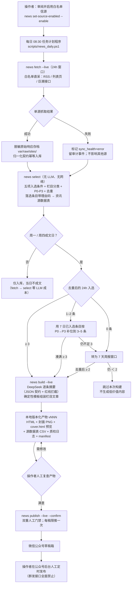

# 营养健康行业资讯：每日运营手册

本手册描述资讯自动线（Phase 4，[ADR-0014](adr/0014-news-line-and-wechat-draft-publishing.md)）的日常操作。自动化链路止于**本地产物**；向微信公众号草稿箱推送永远是人工显式动作。

## 0. 当前流程图



要点：fetch → select 每日无人值守（不走 LLM，保持候选池新鲜），build 只在周一、周四触发（一周两期成文节奏，2026-09-03 依据实测供给确定），全程止步于本地产物；两个分支（周报回退、构建跳过）执行需求文档"不足不强更"；发布环节永远有人工门禁（`--live --confirm`），不在任何调度链内。二期候选：高优先级来源 2–4 小时加密抓取、Exa 兜底补捞（周一补抓）、`freepublish` 定时发布。

## 1. 一次性准备

| 事项 | 命令 / 位置 | 状态说明 |
| --- | --- | --- |
| 导入白名单提案 | `nutrition-radar news seed-sources` | 29 个建议信源，全部停用 |
| 审阅并确认名单 | `nutrition-radar news list-sources` | 人工确认是资讯线唯一固定的内容门禁 |
| 启用确认的信源 | `nutrition-radar news set-source-enabled --name "XX" --enable` | 只有启用的信源会被抓取 |
| 分析后端 | `.env` 的 `RADAR_LLM_*`（DeepSeek key） | `doctor` 报告 `llm_analysis_ready` |
| 封面 Logo（可选） | 放置 `var/assets/earlydata-logo.png` | 未放置时封面正常生成、仅无 Logo 并在 manifest 标注 |
| 微信凭据（发布前） | `.env` 的 `WECHAT_APP_ID` / `WECHAT_APP_SECRET` | 只在要推送草稿箱时需要 |

## 2. 每日自动链路（无发布）

`scripts/news_daily.ps1` 每日执行 `fetch → select`，**仅在周一、周四追加 `build`**（一周两期；非成文日脚本正常退出）。建议用任务计划程序每日 08:30 调用：

```powershell
schtasks /Create /TN "EarlyDataNewsDaily" /SC DAILY /ST 08:30 `
  /TR "powershell -ExecutionPolicy Bypass -File D:\Earlydata\nutrition-signal-radar\scripts\news_daily.ps1"
```

三步也可手动执行：

```powershell
.\.venv\Scripts\nutrition-radar.exe news fetch --live --lookback-hours 24   # 抓取已启用信源
.\.venv\Scripts\nutrition-radar.exe news select                             # 规则筛选分级（无 LLM）
.\.venv\Scripts\nutrition-radar.exe news build --live                       # 摘要成文 + 本地产物
```

产物位于 `var/exports/news-articles/<slug>/vNNN/`：

- `news-article.html`：内联样式排版，可直接粘贴公众号编辑器；
- `news-article.md`：母稿；
- `cover.png`：1800×766 品牌封面（由入库模板 `templates/cover.html` 经本机 Edge/Chrome 无头截图生成，浏览器不可用时自动回退 PIL；`cover.html` 一并导出可直接在浏览器预览）；
- `source-table.csv`：资讯源数据表（含落选条目与理由）；
- `qc-log.json`：质检日志；`manifest.json`：构建元数据（含封面引擎与 Logo 状态）。

入选去重后不足 2 条则跳过本次构建，不生成低价值内容。日报目标是 3–5 条：24 小时窗口只有 1–2 条时，会用过去 7 天已入选、且非同事件的条目按优先级补位；补不满 3 条才改走周报形态。

**跨期不重复**（schema v17 `news_article_items` 关联表）：每次成文把所用条目写入关联表，候选池加载时排除「构建日零点之前」成文的文章已用条目——一周两期各写各的新料，多期链式不回收旧闻。当天创建的关联不排除，因此同日修复后重出 v2+ 看到与上一版相同的候选池。代价：条目在成文时即视为消耗，弃稿不会回收（7 天窗口反正会将其淘汰）。

## 3. 发布（人工确认，手动触发）

检查 HTML 与封面后，人工确认推送草稿箱：

```powershell
.\.venv\Scripts\nutrition-radar.exe news publish --live --confirm --slug news-2026-09-01 --version 1
```

- `--live`：外呼确认；`--confirm`：人工决策确认——两者缺一即拒绝执行；
- 调度链永不包含 publish；每篇成稿只允许推送一次（重复执行会被拒绝并提示已有 media_id）；
- 推送后文章停在公众号草稿箱，**定时发布/群发由你在公众号后台人工操作**（群发接口在本项目中全面禁止）。

## 4. 健康检查与排障

- `news list-sources`：查看每个信源的 `sync_health`（healthy / error / paused）与最近抓取时间；
- 单个信源失败不影响其他信源；`error` 源的错误摘要可在事件表中追溯；
- 原始响应存档在 `var/raw/sites/YYYY-MM-DD/<域名>/`，用于核对解析问题；
- 政府站点改版常导致列表页解析失败：先看 `var/raw/sites/` 快照确认页面结构变化，再调整该源 `entry_url` 或解析配置（`news configure-source` 更新 `parser_version`）；
- 通用解析器约定：锚点 `title` 属性优先于截断的锚文本；支持"2026-09-01""2026年9月1日""09-01"（月-日自动补年份、纯日期按当天末尾计入窗口）等格式；列表页 JS 渲染抓不到内容时，优先换用站点自带的 RSS 或开放接口（如 WordPress 的 `/feed/`、`/wp-json/wp/v2/posts`）；
- 巨潮当前按 `parser_config` 的 `{"searchkey":"保健食品"}` 过滤标题；个股（stock 参数）过滤需先解析 orgId，留待专项调优。

## 5. 首轮实调记录（2026-09-01）

- 市场监管总局（列表页）：解析修复后正常（title 属性 + 月-日日期），当日 24h 窗口无新增；
- 巨潮资讯网（API）：未过滤查询返回 30 条并全部被规则正确判为"与产业无关"；改用 searchkey 过滤后噪声归零；
- HNC 健康营养展：首页为 JS 渲染、无静态新闻列表，已改用 WordPress RSS（10 条全部正确判为窗口外，该展 6 月闭展后暂未更新）；
- 当日入选 0 条 → build 诚实跳过：需求"资讯不足不强更"的真实演示。

### 5.1 全量活体校验（29 源，2026-09-01，脚本 `scripts/validate_news_sources.py`）

通用解析器增强后（锚点 title 属性、月-日短日期、GBK 编码回退、浏览器 UA），当前状态：

- **解析器可用（7）**：市场监管总局、巨潮资讯网、HNC（RSS）、北京市监局、商务部（编码修复后首页可解析）、中国食品科学技术学会、科拓生物/康恩贝（页面无标准列表，待换栏目页）；
- **页面通、需逐站调整入口或解析（15）**：上海/北京市局以外各品牌官网与展会站多为 JS 渲染新闻列表（ADM/Probi/Novonesis/SupplySide 等已探测无公开 RSS），需逐站把 `entry_url` 指向真实静态列表页或专用解析；
- **网络层失败（7）**：卫健委 412 反爬、WonderLab 403、海关总署/东阿阿胶/汤臣倍健/中国营养学会/CFSA 的 TLS 证书或握手问题（CFSA 解析器已人工验证可用，20 条带日期，仅网络波动）；
- **接口未实现（2）**：SEC EDGAR、港交所披露易（预期内，待专项）；
- RSS 批量探测结论：15 个待调源首页均无 feed 声明、常见 feed 路径全部 404，HNC 属旧 WordPress 特例。

启用策略：仅启用复验 `parser_ok` 的信源。

### 5.6 停用源修复轮（2026-09-02，22 个停用源全量复验）

注意：`scripts/validate_news_sources.py` 必须用 venv 解释器跑（`./.venv/Scripts/python.exe`），系统 Python 缺 playwright 会把全部浏览器渲染源误报为 `fetch_failed`。

- **修复并启用（5，当前启用共 19）**：
  - 广东省市场监督管理局（首页浏览器渲染即出带日期列表，近 10 条全部 parser_ok）；
  - 浙江省市场监督管理局（同上，抽检公告/备案公示逐日更新）；
  - 仙乐健康（60 天窗口 1 条：中国专利奖，站点更新慢但解析正常）；
  - 澳优乳业（60 天窗口 2 条企业新闻）；
  - 上海市市场监督管理局（首页是服务门户无新闻列表，改指 `/000/` 图片新闻栏，**静态可解析**无需渲染，10 条带日期）。
- **暂弃（保持停用，理由实测）**：
  - 康恩贝：`/news` 为 JS 分页 SPA，渲染后 DOM 无条目锚点，列表走 XHR；
  - 科拓生物：`#/news` 日期在锚外（2022–2024 旧闻为主），其公告流已由巨潮资讯网覆盖；
  - 华熙生物：渲染间歇性挂起/超时，P2 暂缓；
  - CFSA：列表页实为共享模板壳，静态/渲染解析出的都是首页旧栏目块（2011/2017/2023），需找到真实列表数据源再启用；
  - 国家营养保健食品协会：goto 超时（站点侧）。
- **网络层封锁（维持停用）**：卫健委浏览器渲染仍返回空 body（WAF 头检测）；海关总署证书链损坏（Edge 报 ERR_CERT_AUTHORITY_INVALID，忽略证书后返回拦截错误页），本网络环境无解。
- **接口未实现（专项待做）**：SEC EDGAR、港交所披露易。
- 国外源（ADM/Novonesis/SupplySide West/Fi Global China）本轮渲染可达但列表无日期（卡片式组件），同域过滤亦排除了 ADM 的 Forbes 外链，归入长尾。

### 5.5 天猫国际规则试点（2026-09-01，进行中）与竞对边界澄清

- **行业公众号不接入的定位理由（用户确认）**：庶正康讯等行业媒体是要竞争的**对标对象而非聚合对象**——资讯线的价值在原创整合而非搬运竞对内容。此为 docx 信源边界的战略解释，与"待补证"机制共同构成边界。
- 天猫国际规则（`rule.tmall.hk/#/`、`rulechannel.tmall.com/#/`）：浏览器渲染可达，规则列表与新规则日期（如 2026-07-28）已出现在渲染 DOM 中；但列表项是 JS 组件的可点击块而非 `<a>` 锚点，通用锚点解析器不适用。**待办**：为该站写专用 SPA 提取器（或捕获其 mtop 数据接口），完成后按"平台治理"类目（category=policy）入库为试点源。
- hash 路由锚点支持已进通用解析器（browser 渲染模式下 `#/detail` 链接视为真实链接），覆盖其他 SPA 站点的常见形态。

### 5.4 国外源接入（2026-09-01 第四轮，依赖全局代理存活）

- 代理客户端重启后，7 个国外源全部可连通；**CPHI China、森永乳业、NHNE（找到新闻列表页 `/News/Index/1/?cid=166`）、Probi** 达到 `parser_ok` 并启用，**金达威**（解析正常、90 天无更新）一并启用——当前启用共 **14 个**；
- ADM 官网新闻多为 Forbes 等外链文章，被同域过滤正确排除，归入待深挖；Novonesis/SupplySide/Fi Global 暂无带日期静态列表，待逐站调参；
- 注意：国外源依赖本机代理客户端存活（已按系统代理模式配置）；客户端长期在线是它们保持可用的前提，期间国内 9 源不受影响（已配直连）。

### 5.2 浏览器渲染接入（2026-09-01 第二轮）

对 JS 渲染站新增 Playwright（`channel="msedge"` 复用系统 Edge，免浏览器下载）渲染后端：`html_list` 源在 `parser_config` 配 `{"render":"browser","proxy":"direct","wait_seconds":2}` 即启用。要点：

- **代理按源可配**：`proxy:"direct"` 强制直连（国内站在本机代理客户端挂掉时会全挂），默认继承系统代理（国外站 ADM/Probi 等需要）；`RADAR_BROWSER_PROXY` 可全局覆盖；
- 等待策略：`domcontentloaded` + 默认 2 秒沉淀，可选 `wait_selector`/`wait_seconds`；
- 静态列表仍是第一跳，浏览器只是 JS 站的渲染后端；日期解析新增"锚点文本内日期"兜底（卡片式列表）；
- 第二轮结果：中国营养学会转 `parser_ok`（3 条带日期）；WonderLab 403 解除、科拓生物/康恩贝可渲染；上海/北京市局等首页确无日期列表，需逐站找真实栏目页——长尾调参继续，调好一个启用一个。

### 5.3 上市公司优先攻坚（2026-09-01 第三轮）

- **parser_ok 并已启用（9）**：市场监管总局、巨潮资讯网（按"保健食品"标题过滤）、HNC（RSS）、北京市监局、商务部、中国食品科学技术学会、汤臣倍健（官网动态页）、东阿阿胶（巨潮个股披露页）、中国营养学会；金达威解析正常但 90 天内无更新（暂不启用）。
- 修复的通用问题：① 日期解析的 `max_items` 截断缺陷——导航链接排在新闻列表前时，前 10 个候选全是导航导致误判"无日期"（现扫描上限 200，保留数仍由窗口过滤后裁剪）；② **代理按源策略统一扩展到 requests 会话**（Windows 注册表代理会被 requests 继承，代理客户端挂掉时国内源全挂）：`parser_config` 的 `proxy:"direct"` 同时作用于静态抓取与浏览器渲染；
- 待办长尾：仙乐健康/中国营养保健食品协会站点超时（站点侧）、卫健委 412 反爬、海关总署/CFSA TLS 证书、SEC EDGAR 与港交所 API 解析器、国外源（ADM/Probi/Novonesis/SupplySide/CPHI/Fi Global/森永乳业）等本机代理客户端恢复后自动可用；康恩贝/科拓生物/WonderLab/上海局需继续找真实栏目页。

## 6. 明确不做

- 任何群发路径；
- 无人值守的自动发布（publish 永远需要人工 `--live --confirm`）；
- 高优先级来源 2–4 小时加密抓取（二期再开任务计划程序触发器）；
- Exa 兜底补捞与 pi 单条正文补全（后续辅助切片）。
